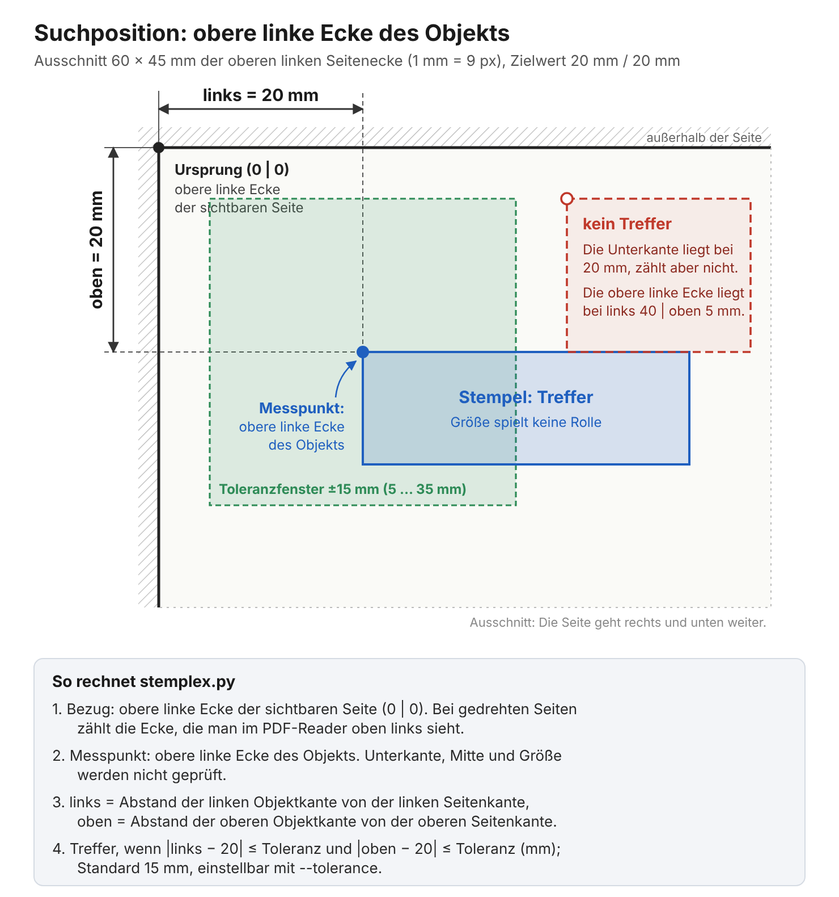

# Anleitung: stemplex.py

## Kurz gesagt

Für 90 % der Fälle brauchst du nur (blendet den Stempel aus, nichts geht verloren):

```bash
python stemplex.py original_scan.pdf
```

Willst du vorher sehen, was passieren würde:

```bash
python stemplex.py original_scan.pdf --dry-run --verbose
```

Und wenn der Stempel wirklich endgültig weg soll:

```bash
python stemplex.py original_scan.pdf --delete
```

## Lange Version

Dieses Skript durchsucht PDF-Seiten (inklusive verschachtelter Form-XObjects) nach positionierten Bildern, Formularen und Annotationen, deren obere linke Ecke an einer festen Stelle der sichtbaren Seite liegt (Standard: 20 mm von links, 20 mm von oben, ±15 mm) – typischerweise ein Stempel –, und blendet diese aus oder löscht sie. Das funktioniert unabhängig vom Seitenformat und von der Seitendrehung.



**Wichtig:** Das Skript geht von minimal und nicht zerstörerisch bis maximal und unumkehrbar vor:

| Stufe | Aufruf | Wirkung |
|---|---|---|
| 1 | `--dry-run` | Nur suchen, nichts verändern, nichts schreiben. |
| 2 | *(Standard)* | Treffer **ausblenden**: Der Stempel bleibt in der Datei, ist aber unsichtbar und lässt sich wieder einblenden. |
| 3 | `--delete` | Treffer **endgültig löschen**. Nicht umkehrbar. |

Ausblenden ist also der **Standardfall**; das Löschen muss ausdrücklich mit `--delete` angeschaltet werden. Gibst du kein `--output` an, wird automatisch `<input>_bereinigt.pdf` im selben Ordner erzeugt (Suffix `_bereinigt` ist im Skript-Kopf als `DEFAULT_OUTPUT_SUFFIX` anpassbar). Willst du nur prüfen, was gefunden würde, ohne etwas zu verändern, nutze `--dry-run`.

Zwei Sicherheitsnetze gibt es eingebaut:

- **Existiert die Ausgabedatei bereits**, bricht das Skript sofort ab (noch bevor irgendetwas an der PDF gelesen oder verändert wird) und verweist auf `--force-output`, falls du das Überschreiben wirklich willst.
- **Werden keine Stempel gefunden**, meldet das Skript `Keine Stempel gefunden. Nichts verändert.` – und zwar immer, auch ohne `--verbose`. In diesem Fall wird auch keine Ausgabedatei geschrieben (nichts zu bereinigen, nichts zu überschreiben).

## Der Normalfall: Stempel in einer Datei ausblenden

```bash
python stemplex.py original_scan.pdf
```

Das war's – kein `--output` nötig. Das Skript läuft dabei **still** (keine Konsolenausgabe) und liefert:

- **`original_scan_bereinigt.pdf`** – die Datei mit ausgeblendetem Stempel, automatisch benannt (Original-Dateiname + `_bereinigt`)

Einen JSON-Bericht gibt es standardmäßig **nicht** – dafür musst du `--report` explizit angeben (siehe unten).

Willst du einen eigenen Ausgabenamen, gib `--output` explizit an:

```bash
python stemplex.py original_scan.pdf --output original_scan_bereinigt.pdf
```

Willst du sehen, was passiert ist, häng `--verbose` an:

```bash
python stemplex.py original_scan.pdf --verbose
```

**Tipp:** Lauf das Skript vorher einmal mit `--dry-run --verbose`, um zu sehen, was überhaupt gefunden würde, bevor du etwas löschst:

```bash
python stemplex.py original_scan.pdf --dry-run --verbose
```

Das verändert nichts an der PDF. Ohne `--report` wird dabei auch keine Datei geschrieben – die Zusammenfassung erscheint nur in der Konsole (wegen `--verbose`).

---

## Alle Optionen im Überblick

| Option | Pflicht? | Beschreibung |
|---|---|---|
| `input_pdf` | ja (immer) | Die zu untersuchende PDF-Datei (positionelles Argument, ohne `--`). |
| `--output <Datei>` | nein | Pfad der bereinigten Ausgabedatei. Fehlt sie, wird automatisch `<input>_bereinigt.pdf` im selben Ordner verwendet (Suffix im Skript-Kopf über `DEFAULT_OUTPUT_SUFFIX` anpassbar). Wird bei `--dry-run` ignoriert. |
| `--force-output` | nein | Erzwingt das Überschreiben, falls die Ausgabedatei bereits existiert. Ohne diese Option bricht das Skript in diesem Fall komplett ab, ohne irgendetwas zu verändern. |
| `--delete` | nein | Löscht Treffer **endgültig aus der Datei**, statt sie nur auszublenden. **Nicht umkehrbar.** Ohne diese Option werden Treffer nur ausgeblendet (Bilder, Formulare und Annotationen gemeinsam über eine standardmäßig ausgeschaltete PDF-Ebene). Siehe Abschnitt „Ausblenden und Löschen“. |
| `--dry-run` | nein | Schaltet jede Veränderung ab: es wird nur gesucht, nichts verändert, keine Ausgabedatei geschrieben. `--output` wird dann nicht benötigt. |
| `--verbose` | nein | Gibt die Zusammenfassung (Trefferliste, Anzahl ausgeblendeter bzw. gelöschter Objekte) in der Konsole aus. Ohne diese Option läuft das Skript komplett still. |
| `--report <Datei>` | nein | Pfad für den JSON-Bericht. **Ohne diese Option wird kein Bericht geschrieben.** |
| `--tolerance <mm>` | nein | Zulässige Abweichung vom Zielwert (20 mm von links, 20 mm von oben, gemessen an der oberen linken Ecke der sichtbaren Seite), in beide Richtungen und für beide Achsen. Standard: 15 mm. Siehe Abschnitt „Wie der Stempel gefunden wird“. |
| `--hash-compare [WERTE...]` | nein | Schaltet SHA256-Hashing ein (standardmäßig **aus**, spart Zeit). Siehe eigener Abschnitt unten. |
| `-h`, `--help` | nein | Zeigt die eingebaute Kurzhilfe an. |

`--dry-run` und `--verbose` lassen sich beliebig kombinieren. `--report` ist davon unabhängig: der JSON-Bericht wird **nur** geschrieben, wenn `--report` explizit angegeben ist – egal welche der folgenden Kombinationen sonst noch gesetzt ist.

| Kombination | Verhalten |
|---|---|
| *(keine Flags)* | Blendet still aus, keine Konsolenausgabe. |
| `--verbose` | Blendet aus **und** zeigt die Zusammenfassung in der Konsole. |
| `--delete` | Löscht endgültig statt auszublenden, sonst wie der Normalfall. |
| `--dry-run` | Verändert nichts, keine Konsolenausgabe. |
| `--dry-run --verbose` | Verändert nichts, zeigt aber die Zusammenfassung – ideal zum Prüfen vor dem eigentlichen Lauf. |
| `+ --report <Datei>` | Zusätzlich zu jeder der obigen Kombinationen: schreibt den JSON-Bericht in die angegebene Datei. |

### Ausblenden und Löschen

**Standard: ausblenden.** Der Stempel bleibt in der Datei erhalten und wird nur unsichtbar geschaltet:

```bash
python stemplex.py original_scan.pdf
```

- **Bilder und Formulare (XObjects):** Die betroffene Zeichenanweisung wird in eine PDF-Ebene („Optional Content“) mit dem Namen `Stempel (ausgeblendet)` gelegt, die im Dokument standardmäßig **ausgeschaltet** ist. Den Ebenennamen kannst du im Skript-Kopf über `HIDE_LAYER_NAME` ändern.
- **Annotationen (Links, Kommentare, Formularfelder, Stempel-Annotationen):** Sie werden über **dieselbe** Ebene gesteuert (`/OC`-Verweis), nicht über ein separates Hidden-Flag. Das ist wichtig: Manche Stempel-/Signatur-Tools legen einen Stempel als Annotation statt als Bild an – typischerweise bei Dokumenten, die direkt als PDF erzeugt wurden (z. B. über einen PDF-Drucker), statt eingescannt zu sein. Ohne den `/OC`-Verweis gäbe es für solche Stempel keine Möglichkeit, sie über das Ebenen-Panel wieder einzublenden.
- **Wieder einblenden:** In Readern mit Ebenen-Panel (z. B. Adobe Acrobat, Foxit, Okular) die Ebene `Stempel (ausgeblendet)` einschalten – das gilt einheitlich für Bilder, Formulare und Annotationen.
- Die Datei wird dabei mindestens auf PDF-Version 1.5 gehoben, weil Ebenen erst ab dieser Version existieren.

**Ausblenden ist keine sichere Entfernung.** Der Stempel steckt weiter in der Datei und lässt sich mit passender Software einblenden oder auslesen. Reader, die Ebenen (Optional Content) nicht unterstützen, zeigen ihn unter Umständen weiterhin an – das betrifft inzwischen Bilder, Formulare und Annotationen gleichermaßen.

**Endgültig löschen mit `--delete`.** Wenn der Inhalt wirklich verschwinden soll (z. B. vor Weitergabe der Datei), schalte das Löschen ausdrücklich an:

```bash
python stemplex.py original_scan.pdf --delete
```

Die Zeichenanweisungen bzw. Annotationen werden dann aus der Ausgabedatei entfernt. Das lässt sich in der Ausgabedatei **nicht rückgängig machen**. Deine Originaldatei bleibt dabei unverändert, denn das Skript schreibt immer in eine neue Datei (siehe Überschreib-Schutz). Prüfe vorher am besten mit `--dry-run --verbose`, was gefunden wird.

Ausgabename, Überschreib-Schutz, `--verbose`, `--report` und die „keine Stempel gefunden“-Meldung verhalten sich in beiden Modi gleich. Bei `--dry-run` haben weder Standard noch `--delete` eine Wirkung.

### Überschreib-Schutz

Existiert die Zieldatei (egal ob automatisch benannt oder über `--output` angegeben) bereits, bricht das Skript **sofort** ab – noch bevor die PDF überhaupt geöffnet oder durchsucht wird:

```
Ausgabedatei existiert bereits: original_scan_bereinigt.pdf
Abgebrochen, um sie nicht versehentlich zu überschreiben. Mit --force-output kann das Überschreiben erzwungen werden.
```

Willst du das Überschreiben ausdrücklich erlauben:

```bash
python stemplex.py original_scan.pdf --force-output
```

Bei `--dry-run` greift dieser Schutz nicht, da dabei ohnehin keine Datei geschrieben wird.

### Wenn keine Stempel gefunden werden

Findet das Skript nichts Passendes, meldet es das **immer** in der Konsole – auch ohne `--verbose`:

```
Keine Stempel gefunden. Nichts verändert.
```

In diesem Fall wird **keine** Ausgabedatei geschrieben (es gibt ja nichts zu bereinigen). Ein JSON-Bericht wird trotzdem erzeugt, falls `--report` gesetzt ist – er zeigt dann einfach eine leere Trefferliste.

### Wie der Stempel gefunden wird (Position und `--tolerance`)

Gesucht wird über die **obere linke Ecke** des Objekts, gemessen von der oberen linken Ecke der **sichtbaren Seite**:

- Abstand von der linken Seitenkante: **20 mm**
- Abstand von der oberen Seitenkante: **20 mm**
- erlaubte Abweichung: **±15 mm** (Standard) in beide Richtungen und für beide Achsen

Die Größe des Stempels spielt keine Rolle, denn Stempel haben kein einheitliches Format. Eine Mindestbreite oder -höhe gibt es nicht mehr.

**Seitenformate und Drehung:** Die Abstände werden für jede Seite einzeln berechnet. Dadurch greift dieselbe Suche auf A4, auf A5 und auf jedem anderen Format, auch wenn sie in einer Datei gemischt sind. Seiten mit `/Rotate 90`, `180` oder `270` werden ebenfalls berücksichtigt: Gemeint ist immer die Ecke, die du im PDF-Reader oben links siehst. Wirkt die Seite durch eine CropBox kleiner als ihre MediaBox, zählt die CropBox, also der sichtbare Ausschnitt.

**Zielwert ändern:** `TARGET_LEFT_MM` und `TARGET_TOP_MM` im Skript-Kopf.

**Toleranz ausprobieren:** Mit `--tolerance` stellst du die Abweichung pro Lauf ein, ohne das Skript zu ändern. Komma und Punkt sind erlaubt. Den Standard ändert `DEFAULT_TOLERANCE_MM` im Skript-Kopf.

```bash
python stemplex.py original_scan.pdf --dry-run --verbose --tolerance 5
```

Findet das Skript mit der Standardtoleranz nichts, obwohl ein Stempel da ist, probiere erst `--dry-run --verbose --tolerance 6` und sieh dir die ausgegebene Position an. Mit `--report bericht.json` bekommst du zusätzlich **alle** positionierten Objekte jeder Seite, jeweils mit `visual_mm` (`left_mm` und `top_mm` sind der Abstand von links und oben in mm, dazu die sichtbare Breite und Höhe `width_mm` und `height_mm`). So siehst du, wo der Stempel tatsächlich liegt, und kannst Zielwert und Toleranz danach einstellen.

Zu große Toleranzen können andere Objekte in der Nähe der Ecke erfassen (z. B. Logos oder Links). Prüfe die Treffer deshalb vor dem eigentlichen Lauf mit `--dry-run --verbose`.

### `--hash-compare` im Detail

Standardmäßig wird **kein** Hash berechnet – das ist der schnellste Modus und für die meisten Anwendungsfälle ausreichend, da die Position bereits das Suchkriterium ist.

Drei Varianten:

**1. Ganz ohne `--hash-compare`** (Standard): kein Hashing, schnellster Modus.

```bash
python stemplex.py original_scan.pdf --output bereinigt.pdf
```

**2. `--hash-compare` ohne weitere Werte**: SHA256 wird für Treffer berechnet. Bei `--verbose` erscheint er direkt in der Konsole (Zeile `SHA256: ...`), zusätzlich landet er im JSON-Bericht (Feld `stream_sha256`), falls `--report` gesetzt ist. Nützlich, um dir z. B. einen Referenz-Hash für später zu notieren – dafür reicht `--verbose`, `--report` ist nicht nötig:

```bash
python stemplex.py original_scan.pdf --hash-compare --dry-run --verbose
```

**3. `--hash-compare` mit bekannten Hashes**: zusätzlich wird geprüft, ob der gefundene Stempel zu einem bereits bekannten passt (Feld `hash_known: true/false` im Bericht, in der Konsole bei `--verbose` als `SHA256: ... (bekannt)` bzw. `(unbekannt)`). Werte können direkt als SHA256-Hexstring übergeben werden oder als Pfad zu einer Textdatei mit einem Hash pro Zeile (Zeilen mit `#` werden als Kommentar ignoriert):

```bash
python stemplex.py original_scan.pdf \
  --hash-compare d72e565c83fe09e81aeae5d39f01023e6deee72288027a452f26803d7c394da2 \
  --output bereinigt.pdf
```

```bash
python stemplex.py original_scan.pdf \
  --hash-compare bekannte_stempel.txt \
  --output bereinigt.pdf
```

---

## Weitere Beispiele

**Mehrere Dateien nacheinander bereinigen** (Bash-Schleife):

```bash
for datei in *.pdf; do
  python stemplex.py "$datei" --output "bereinigt_${datei}"
done
```

Läufst du die Schleife ein zweites Mal (z. B. weil ein paar Dateien fehlgeschlagen sind), brechen die bereits erfolgreich bereinigten Dateien wegen des Überschreib-Schutzes ab. Für einen erzwungenen erneuten Lauf über alle Dateien: `--force-output` ergänzen.

**Stempel endgültig löschen statt ausblenden:**

```bash
python stemplex.py original_scan.pdf --delete --verbose
```

**JSON-Bericht explizit anfordern:**

```bash
python stemplex.py original_scan.pdf --dry-run --report /tmp/pruefung.json
```

**Erst prüfen, ob der gefundene Stempel wirklich der erwartete ist, dann erst ausblenden:**

```bash
# 1. Erst nur suchen und Hash notieren (nichts wird verändert)
python stemplex.py original_scan.pdf --hash-compare --dry-run --verbose

# 2. Dann mit dem Referenz-Hash abgleichen und ausblenden
python stemplex.py original_scan.pdf \
  --hash-compare <der-notierte-hash> \
  --output bereinigt.pdf --verbose
```

